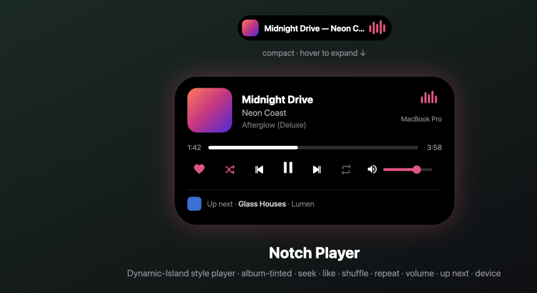

# Notch Player

A Spicetify extension that turns the basic macOS "Now Playing" widget into a **Dynamic-Island style notch player** at the top of the Spotify window.



## Features

The compact pill shows artwork, a scrolling title and a live visualizer. Hover it to expand:

- Large album art, plus title, artist and album. Click any of them to open that page.
- Seek bar you can drag to scrub, with elapsed and total time
- Like (save to Liked Songs), shuffle, previous, play/pause, next and repeat (off, all, one)
- Volume slider and mute button. Scroll on the island to change volume.
- **Up next**: the next track in your queue. Click it to open the queue.
- **Playing on**: the active Spotify Connect device
- Accent colour and glow taken from the current album art
- Expands briefly when the song changes
- Double-click the compact pill to play or pause

## Settings

Open the profile menu (top right), choose **Notch Player**, and set:

- Show or hide the player (shortcut: <kbd>Ctrl</kbd>+<kbd>Alt</kbd>+<kbd>N</kbd>)
- Position: center, left or right
- Expand on song change
- Visualizer bars
- Up next
- Album-art tint
- Hide Spotify's own bottom player bar

## Install

**Marketplace:** search for "Notch Player".

**Manual:**

```sh
cp notchPlayer.js "$(spicetify -c | xargs dirname)/Extensions/"
spicetify config extensions notchPlayer.js
spicetify apply
```

## License

MIT
