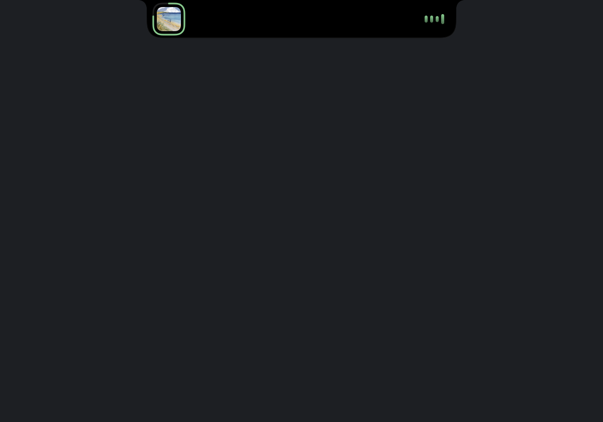

# Notch Player

Turns your MacBook's **physical notch** into a Dynamic-Island style Spotify player. It sits flush with the notch, appears above every app, and is fast because it's native SwiftUI.


**Collapsed:** the album art and a live visualizer sit on either side of the notch.



## Features

Hover the notch to expand it:

- **Live synced lyrics.** The previous, current and next lines roll by as the song plays.
- Album art, title, artist and album. Click any of them to open that page in Spotify.
- Ambient glow, accent colour and tint taken from the album art
- Seek bar you can drag to scrub, with elapsed and remaining time
- Like, shuffle, previous, play/pause, next and repeat (off, all, one)
- Volume bar
- **Up next** from your queue, and the **active Spotify Connect device**
- Long titles scroll instead of being cut off

In the collapsed notch:

- **A real audio visualizer.** The app listens to Spotify's own audio output and shows bass, low-mid, high-mid and treble. It's timed to what you hear, including the delay of Bluetooth headphones. This needs macOS 14.2 or later and the *System Audio Recording* permission. Nothing is recorded or stored. Without it, the bars follow Spotify's beat data.
- A thin progress ring around the album art
- When the song changes, the title and artist slide in briefly. The player doesn't open on its own.

## How it works

There are two parts:

1. **Spicetify extension** (`notchPlayer.js`, from the Marketplace). It runs inside Spotify, reads the full player state, queue and lyrics, and carries out the controls.
2. **Notch Player.app** (native macOS app, `app/`). It draws the island in the physical notch, above every app, and talks to the extension over `ws://127.0.0.1:47823`. It only accepts connections from your own Mac.

If the app isn't running, the extension falls back to a pill inside the Spotify window. You can configure it from the profile menu → **Notch Player**.

## Install

1. Install **Notch Player** from the Spicetify Marketplace, or add it manually:
   ```sh
   cp notchPlayer.js ~/.config/spicetify/Extensions/
   spicetify config extensions notchPlayer.js && spicetify apply
   ```
2. Download `Notch-Player.zip` from [Releases](../../releases/latest), unzip it, and move **Notch Player.app** to `/Applications`.
   The app isn't notarized, so the first time you open it, right-click it and choose **Open**.
3. To keep the notch always available, click the ♪ menu-bar icon and choose **Launch at Login**.

### Build the app yourself

You need the Xcode Command Line Tools and macOS 13 or later.

```sh
app/build.sh   # → app/build/Notch Player.app (universal)
```

## License

MIT
